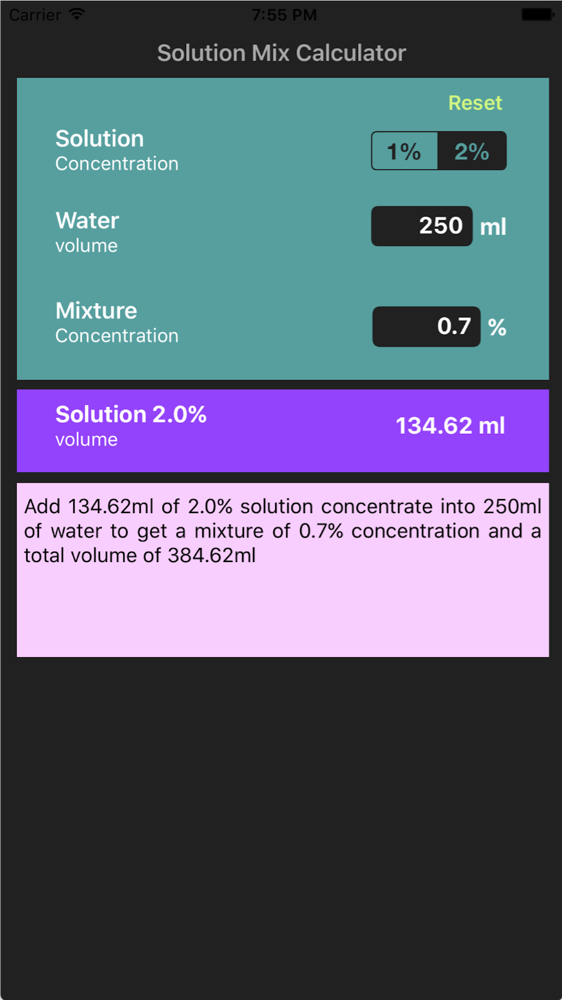

# Solution Mix

A simple, fast iOS calculator, built mainly for doctors, for lidocaine solution calculations.

Published on the App Store as **Solution Mix** in January 2017, retired from the store in 2021 and open-sourced here. Together with my other two published apps (HealthTexter and RwyXwind), it reached over 10,000 downloads in total.

## Built with

- Swift and Xcode

## Status

No longer maintained. The code is kept here as a record of the app.

## Author

ion-

